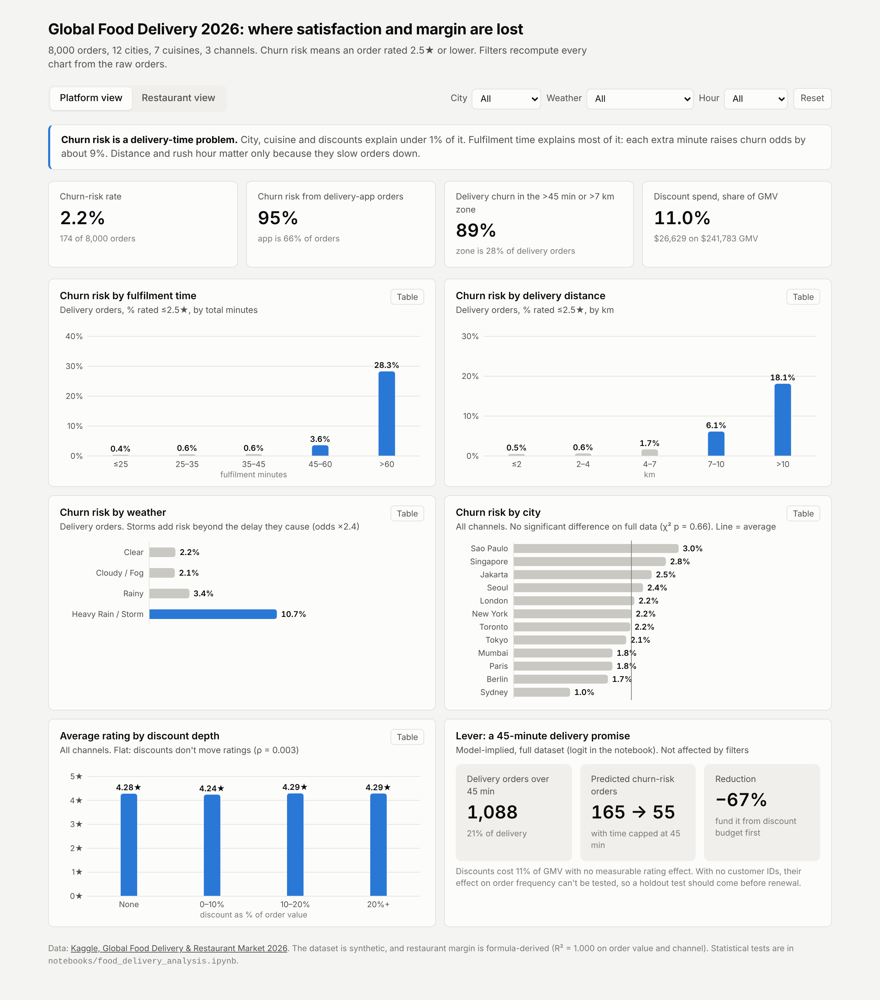
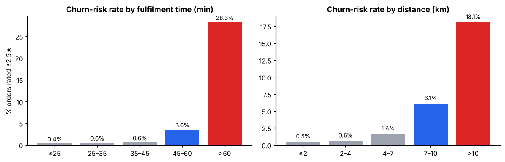
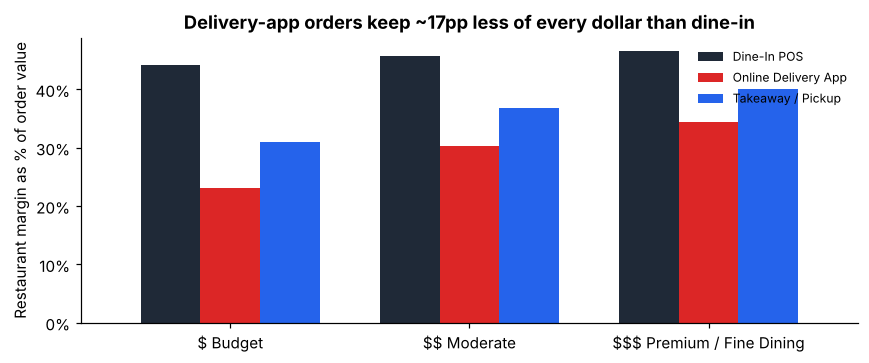
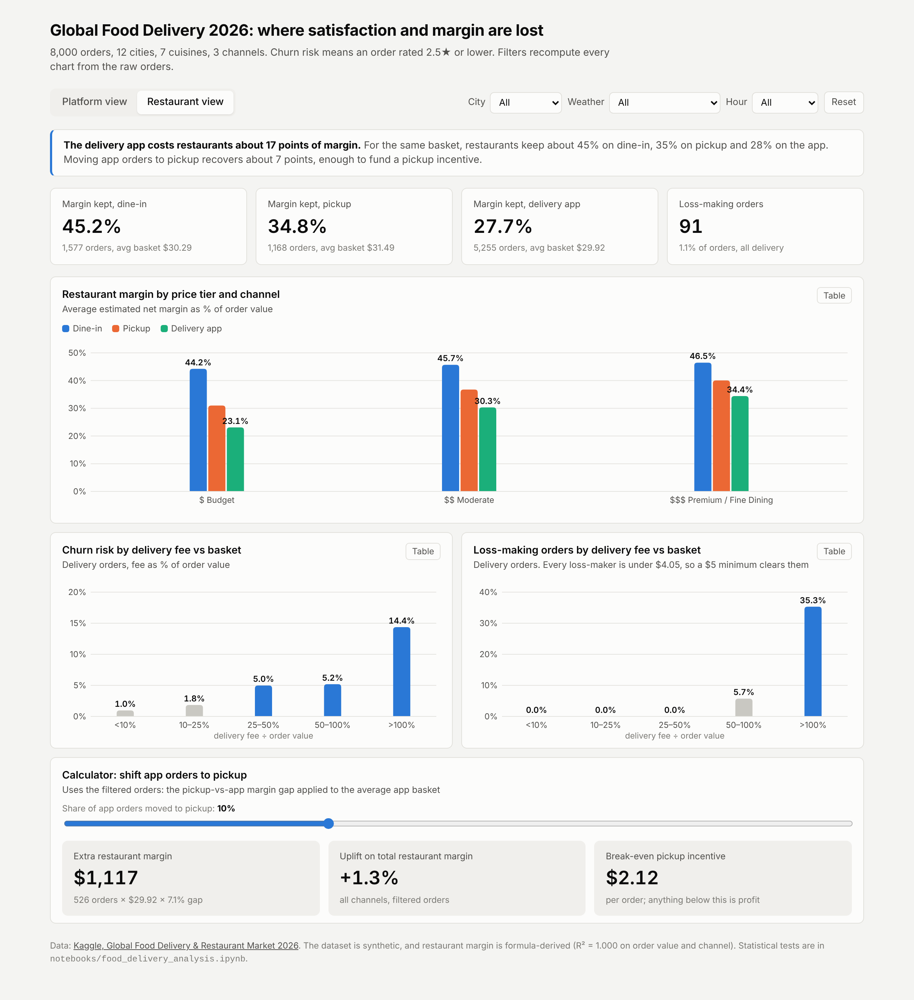

# Where food delivery loses customers and margin

An analysis of 8,000 food orders across 12 cities, 7 cuisines and 3 channels (delivery app, dine-in, pickup), from two angles: a delivery platform protecting satisfaction, and a restaurant protecting margin. The statistical work is in a Python notebook. The dashboard is a single HTML file.

**[Open the live dashboard](https://alikhan-1301.github.io/global-food-delivery-analysis/dashboards/)**

## Result

Churn risk in this market is a delivery-time problem. Fulfilment time drives it. City, cuisine and discounts barely register. 95% of churn-risk orders come through the delivery app, and 85% sit in the 28% of delivery orders that run past 45 minutes or 7 km.

For restaurants, the delivery app is the expensive channel. On the same basket they keep 45% on dine-in, 35% on pickup and 28% on the app.



## Hypotheses

| | Hypothesis | Verdict |
|---|---|---|
| H0 | City and cuisine drive satisfaction and margin | Rejected |
| H1 | Churn risk follows fulfilment time; distance and rush hour act through time; storms add their own risk | Supported |
| H2 | Discounts buy satisfaction | Rejected |
| H3 | The delivery app compresses restaurant margin, and pickup recovers part of it | Supported |

## Findings

### City and cuisine explain almost nothing

Churn risk doesn't differ significantly by city (χ² p = 0.66) or cuisine (p = 0.50). Average restaurant margin ranges from $10.03 to $11.27 across cities on a basket of about $30. City, cuisine and discount together explain under 1% of churn variance in a logistic model (pseudo-R² 0.009). Adding the operational variables lifts it to 0.36.

### Fulfilment time drives churn risk

| Fulfilment time | Delivery orders | Churn risk |
|---|---|---|
| 25 min or less | 1,280 | 0.4% |
| 25–35 min | 1,760 | 0.6% |
| 35–45 min | 1,127 | 0.6% |
| 45–60 min | 667 | 3.6% |
| Over 60 min | 421 | 28.3% |

Time and distance are correlated (ρ ≈ 0.75), so a logistic regression on delivery orders separates them, with city and cuisine controlled:

| Variable | Odds ratio | p-value |
|---|---|---|
| Fulfilment time (per minute) | 1.09 | < 0.001 |
| Heavy rain / storm | 2.38 | 0.003 |
| Distance (per km) | 0.99 | 0.71 |
| Peak hour | 0.72 | 0.26 |
| Delivery fee ÷ order value | 1.25 | 0.41 |
| Discount % | 1.00 | 0.95 |

Each extra minute raises churn odds by about 9%. Distance and rush hour lose significance once time is in the model: they hurt because they slow orders down. Storms add risk at the same wait, so customers judge storm orders more harshly.



### Discounts don't buy satisfaction

Average rating is 4.28 with no discount and 4.29 at 20%+ off. The rank correlation between discount depth and rating is 0.003 (p = 0.77). Discounts cost 11% of GMV ($26,629 on $241,783).

The dataset has no customer IDs or timestamps, so it can't show whether discounts drive repeat orders. The claim is narrower: discounts don't improve the order they're applied to.

### The delivery app costs restaurants about 17 points of margin

| Price tier | Dine-in | Pickup | Delivery app |
|---|---|---|---|
| $ Budget | 44.2% | 31.0% | 23.1% |
| $$ Moderate | 45.7% | 36.8% | 30.3% |
| $$$ Premium | 46.5% | 40.0% | 34.4% |

Only 91 orders (1.1%) lose money. All are delivery orders under $4.05, so a $5 minimum basket removes every one.



## Recommendations

**Platform: hold delivery to 45 minutes.** Use dispatch radius and batching rules so no order is quoted beyond 45 minutes, and tighten the limit in storms. In the fitted model, capping fulfilment at 45 minutes cuts predicted churn-risk orders from 165 to 55 (−67%). It affects 1,088 orders, 21% of delivery.

**Platform: test the discount budget before renewing it.** At 11% of GMV with no measurable satisfaction effect, run a holdout to measure its effect on frequency, and fund the time limit from it first.

**Restaurants: push pickup and set a $5 delivery minimum.** Pickup keeps about 7 points more of each app basket. Moving 10% of app orders to pickup adds about $1,100 of margin in this sample (+1.3%), and any pickup incentive under $2.12 per order pays for itself. The dashboard has a calculator for other shares.



## Assumptions and limits

- **Churn risk** means an order rated 2.5★ or lower (the dataset's `Dissatisfied-ChurRisk-1to2Star` tier, which despite its name includes 2.5). There's no customer ID, so real retention isn't observed.
- **Restaurant margin** is a modelled field. It is an exact function of order value and channel (R² = 1.000), so margin findings describe the dataset's cost model, not accounting data.
- `customer_satisfaction_tier` and `primary_satisfaction_driver` are derived from the rating, so they're left out as predictors to avoid leakage. The LLM-written `cot_market_dynamics_rationale` column is dropped.
- **The dataset is synthetic.** The findings describe how this data behaves. Real order logs would be needed to size the effects in a live market.
- The 45-minute and pickup figures are model-implied counterfactuals, not observed outcomes.

## Repository

```
data/        source CSV (Kaggle)
notebooks/   food_delivery_analysis.ipynb, with all tests and outputs
dashboards/  index.html, a self-contained interactive dashboard (filters, tooltips, table views, dark mode)
figures/     charts used in this README
```

To reproduce:

```bash
pip install -r requirements.txt
jupyter nbconvert --to notebook --execute --inplace notebooks/food_delivery_analysis.ipynb
```

Data: [Global Food Delivery & Restaurant Market 2026](https://www.kaggle.com/datasets/luthfimuthathohirin/global-food-delivery-restaurant-market-2026) on Kaggle.
